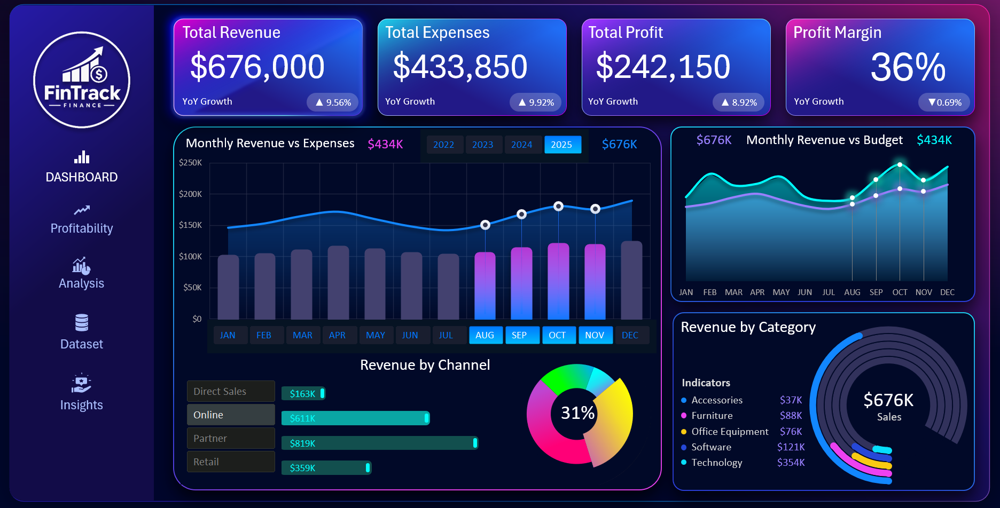
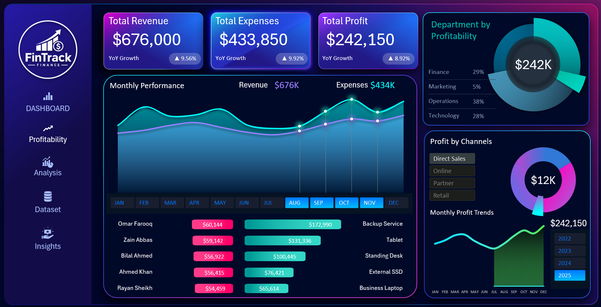

# FinTrack – Financial Analytics Dashboard

## 📊 Project Overview

FinTrack is an interactive financial analytics project designed to monitor business performance, analyze financial trends, and generate actionable business insights.

The dashboard provides a comprehensive overview of revenue, expenses, profitability, departmental performance, and sales channels to support data-driven decision-making.

## 🎯 Project Objectives

- Monitor overall financial performance through key KPIs.
- Analyze revenue, expenses, and profit trends.
- Evaluate monthly financial performance.
- Identify high-performing product categories and departments.
- Analyze sales channel profitability.
- Identify opportunities to improve cost efficiency and business profitability.

## 📈 Dashboard Preview

### Page 1 – Financial Overview

**Key Performance Indicators:**
- Total Revenue: $940K
- Total Expenses: $613.27K
- Total Profit: $326.73K
- Profit Margin: 35%

**Key Analysis:**
- Monthly Revenue vs Expenses
- Monthly Revenue vs Budget
- Revenue by Sales Channel
- Revenue by Product Category

### Page 2 – Department & Channel Performance

**Key Performance Indicators:**
- Total Revenue: $3.15M
- Total Expenses: $2.09M
- Total Profit: $1.06M
- Profit Margin: 33.7%

**Key Analysis:**
- Monthly Financial Performance
- Department-wise Profitability
- Profit by Sales Channels
- Monthly Profit Trends
- Employee and Product Performance

## 🔍 Key Business Insights

- Technology is the leading revenue-generating category, contributing $450K.
- The first dashboard reports a 35% overall profit margin.
- Technology and Operations contribute the highest shares of departmental profitability at 42% and 32%, respectively.
- Monthly trends highlight fluctuations in revenue and expenses throughout the year.
- Monitoring departmental and channel-level profitability can help identify opportunities for better financial performance.

## 🛠️ Tools & Technologies

- Microsoft Excel
- CSV Dataset
- Data Analysis
- Financial Reporting
- Dashboard Design & Visualization

## 📁 Project Files

| File | Description |
|---|---|
| [Dataset.csv](Dataset.csv) | Financial dataset |
| [FinTrack Finance Project.xlsb](FinTrack%20Finance%20Project.xlsb) | Complete Excel dashboard project |
| [Page 1 Preview](page-1.png) | Financial Overview Dashboard |
| [Page 2 Preview](page-2.png) | Department & Channel Performance Dashboard |

## 💡 Project Outcome

FinTrack transforms raw financial data into meaningful business insights through interactive dashboards and KPI-driven analysis. It helps stakeholders monitor financial performance, evaluate profitability, identify business trends, and make informed decisions.

---
## ⭐ Support

If you found this project useful or liked the dashboard, please consider giving this repository a **Star ⭐** on GitHub. Your support is appreciated!

Feel free to explore, share feedback, and connect with me.

---

**Project Name:** FinTrack – Financial Analytics  
**Category:** Finance & Business Intelligence  
**Developed By:** [Muhammad Jan](https://www.linkedin.com/in/muhammad-jan-a98134341/)
